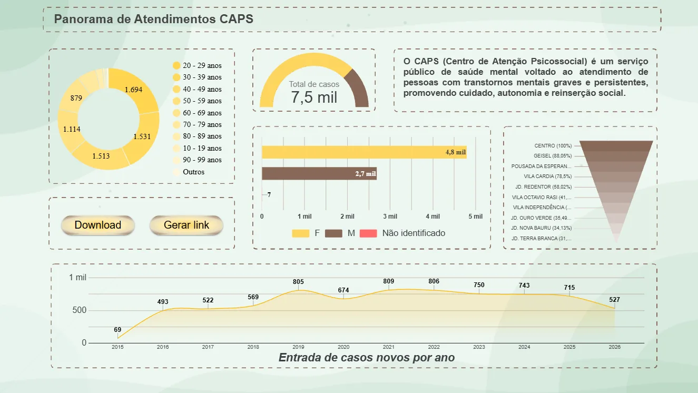

# Portfólio · Mateus Ernandes

> **Transformo trabalho repetitivo em software que roda sozinho.**


Site pessoal de **Mateus Ernandes**, estudante de Engenharia de Software na Unisagrado (Bauru/SP), reunindo projetos de **automação em Python, dados de saúde pública e software web, mobile e IoT**. O portfólio foi feito para apresentar meu trabalho na busca por um **estágio em AI Engineering**.



---

## Sumário

- [Sobre o projeto](#sobre-o-projeto)
- [Seções do site](#seções-do-site)
- [Projetos em destaque](#projetos-em-destaque)
- [Funcionalidades técnicas](#funcionalidades-técnicas)
- [Stack](#stack)
- [Estrutura de pastas](#estrutura-de-pastas)
- [Rodar localmente](#rodar-localmente)
- [Publicar no GitHub Pages](#publicar-no-github-pages)
- [Privacidade](#privacidade)
- [Licença](#licença)
- [Contato](#contato)

---

## Sobre o projeto

O portfólio é uma **página única** escrita em HTML, CSS e JavaScript puros:

- **Zero dependências e zero build:** sem frameworks, bundlers ou `npm install`. Basta abrir o `index.html`.
- **Um único arquivo de código:** estilos e scripts ficam embutidos no `index.html`; a pasta `img/` guarda as mídias.
- **Leve:** imagens em `.webp`, vídeo curto em `.mp4` com pôster e carregamento preguiçoso (`loading="lazy"`, `preload="metadata"`).
- **Dark-first:** tema escuro por padrão, com tema claro automático (preferência do sistema) ou manual.

## Seções do site

| # | Seção | Conteúdo |
|---|-------|----------|
| — | **Hero** | Apresentação, links para LinkedIn e GitHub, números de impacto e um terminal animado simulando a automação do CAPS |
| 01 | **Sobre** | Como uso automação e IA para devolver tempo às equipes |
| 02 | **Projetos com clientes reais** | CAPS Girassol (automações + dashboard) e site da psicóloga Tariane Oliveira |
| 03 | **Pessoais e faculdade** | Dashboard do Zika vírus, sistema Task, alimentador pet IoT e app de catálogo |
| 04 | **Stack** | Ferramentas agrupadas em IA & automação, back-end & dados, front-end & mobile e ferramentas |
| 05 | **Por que AI Engineering** | O que um time de IA precisa × onde já fiz isso nos meus projetos |
| 06 | **Formação** | Graduação, bootcamp e experiência prática |
| 07 | **Contato** | E-mail com botão de copiar, LinkedIn e GitHub |

## Projetos em destaque

### Com clientes reais

- **CAPS Girassol (Bauru/SP): automação de processos + dashboard**
  5 programas em Python com interface desktop que automatizam rotinas da equipe (ex.: abertura de ficha de caso novo gera pasta, documento e registro na planilha) e um painel com 7,5 mil atendimentos de 2015 a 2026.
  `Python` `Google Sheets` `Looker Studio` · [Abrir dashboard](https://datastudio.google.com/reporting/2bcfe83b-db07-42c8-ac83-20b9915bc62b)

- **Psicóloga Tariane Oliveira: site profissional**
  Site responsivo em domínio próprio, com FAQ em acordeão, mapa, galeria e botão de WhatsApp.
  `Web` `Responsivo` · [Visitar site](https://psicologatarianeoliveira.com.br/)

### Pessoais e acadêmicos

- **Arboviroses: dashboard do Zika vírus (2016)**
  Base do OpenDataSUS tratada e transformada em painel com 281 mil notificações, filtros por estado, município e período, mapa coroplético e destaque para gestantes.
  `Looker Studio` `OpenDataSUS` · [Abrir dashboard](https://datastudio.google.com/reporting/e4546028-47da-43c3-8fd9-0bcbe7b6c855)

- **Task: gestão de tarefas (Bootcamp, Grupo 14)**
  Quadro de tarefas com AJAX, filtros dinâmicos, indicadores e validação no back-end com PDO e prepared statements.
  `PHP` `PostgreSQL` `jQuery` · [Ver código](https://github.com/mat-ernandes/Task-bootcamp)

- **Alimentador pet a distância (IoT, Grupo 13)**
  ESP32 recebe o comando do app Blynk, gira o servo, acende o LED e mostra o status no LCD.
  `ESP32` `C++/Arduino` `Blynk` · [Abrir simulação no Wokwi](https://wokwi.com/projects/427651579508175873)

- **Catálogo de livros e filmes (Android)**
  App feito no MIT App Inventor com login pelo Firebase, capa pela câmera, notas e busca.
  `MIT App Inventor` `Firebase Auth`

## Funcionalidades técnicas

- **Tema claro/escuro:** segue `prefers-color-scheme` e pode ser alternado no botão da barra; a escolha fica salva em `localStorage`.
- **Hero com "rede de dados":** `<canvas>` com partículas conectadas que reagem ao ponteiro e se adaptam às cores do tema.
- **Terminal animado:** reproduz, linha a linha, a execução da automação de abertura de ficha.
- **Contadores animados** nos números de impacto, formatados em `pt-BR`.
- **Revelação ao rolar** com `IntersectionObserver`, apenas para elementos fora da primeira tela.
- **Cards com spotlight e leve inclinação 3D** que acompanham o ponteiro (só em dispositivos com ponteiro preciso).
- **Barra de progresso de leitura** na navegação fixa.
- **Prévia de site com rolagem automática** dentro de uma moldura de navegador.
- **Diagrama SVG animado** do alimentador pet (fios com tracejado em movimento).
- **Vídeo que toca só quando visível** na tela.
- **Copiar e-mail** com a Clipboard API e fallback de seleção de texto.

### Acessibilidade e responsividade

- Respeita `prefers-reduced-motion`: desliga animações e transições.
- Foco visível (`:focus-visible`), `aria-label` em elementos visuais, `role="status"` para avisos e texto alternativo em todas as imagens.
- Layout responsivo com CSS Grid, testado de celular a desktop, incluindo `safe-area-inset` para telas com notch.

## Stack

| Camada | Tecnologias |
|--------|-------------|
| Estrutura | HTML5 semântico |
| Estilo | CSS3: custom properties, Grid, Flexbox, `color-mix()`, `clamp()`, animações e media queries |
| Comportamento | JavaScript vanilla (ES6+): Canvas 2D, IntersectionObserver, Clipboard API, `localStorage` |
| Tipografia | Google Fonts: Bricolage Grotesque, Geist e JetBrains Mono |

## Estrutura de pastas

```
portfolio2026/
├── index.html           # página completa (HTML + CSS + JS embutidos)
├── img/
│   ├── mateus.webp      # foto (também usada como favicon e og:image)
│   ├── caps.webp        # dashboard do CAPS Girassol
│   ├── caps-automacao.mp4
│   ├── caps-poster.jpg  # pôster do vídeo
│   ├── tariane.webp     # captura do site da psicóloga
│   ├── zika.webp        # dashboard do Zika vírus
│   ├── task.webp        # sistema Task
│   ├── app-home.webp    # app de catálogo: tela inicial
│   └── app-lista.webp   # app de catálogo: lista
├── LICENSE
└── README.md
```

## Rodar localmente

Como não há dependências, há duas opções:

1. **Abrir direto:** dê dois cliques no `index.html`.
2. **Servidor local** (recomendado, para o vídeo e os caminhos funcionarem como em produção):

   ```bash
   git clone https://github.com/mat-ernandes/portfolio2026.git
   cd portfolio2026
   python -m http.server 8000
   ```

   Depois acesse <http://localhost:8000>.

## Publicar no GitHub Pages

1. No repositório, vá em **Settings → Pages**.
2. Em **Build and deployment**, escolha **Deploy from a branch**, branch `main` e pasta `/ (root)`.
3. Salve. Em alguns minutos o site fica disponível em `https://mat-ernandes.github.io/portfolio2026/`.

## Privacidade

O projeto do CAPS lida com dados sensíveis de saúde. Por isso, **nomes de pacientes foram ocultados** no vídeo da automação e no terminal animado, e o dashboard exibe apenas dados agregados.

## Licença

- O **código-fonte** (HTML, CSS e JavaScript) está sob a [licença MIT](LICENSE).
- A **foto pessoal, as capturas de tela de projetos e clientes, o vídeo** da pasta `img/` e os **textos** do portfólio **não** estão cobertos pela MIT: todos os direitos reservados. Detalhes no arquivo [LICENSE](LICENSE).

## Contato

- **E-mail:** mateus_ernandes@outlook.com
- **LinkedIn:** [mateus-ernandes](https://www.linkedin.com/in/mateus-ernandes-8358542b1/)
- **GitHub:** [@mat-ernandes](https://github.com/mat-ernandes)

---

© 2026 Mateus Ernandes
